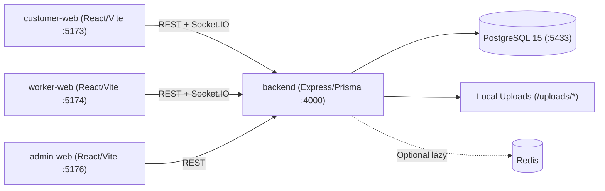

# Architecture

## System Architecture

- **Independent Frontends**: `customer-web`, `worker-web`, and `admin-web` do **not** share a local workspace package or UI library. Each maintains its own `src/api/`, `src/app/AppProviders.tsx`, `src/contexts/AuthContext.tsx`, `src/i18n/`, `src/layouts/`, and `src/pages/`. (VERIFIED: `docs/PROJECT_KNOWLEDGE.md`, `customer-web/src/`, `worker-web/src/`, `admin-web/src/`)
- **Backend Layering**:
  `route registration (backend/src/routes/) -> middleware (auth, rateLimit, validate, i18n) -> controller (backend/src/controllers/) -> service (backend/src/services/) -> Prisma / repository (backend/src/repositories/) -> response helper (backend/src/utils/api.ts)` (VERIFIED: `backend/src/app.ts`, `docs/PROJECT_KNOWLEDGE.md`)

## Dual API Prefixing

In `backend/src/app.ts`, all 19 router registrations are mounted under **both**:
- `/api/v1/:locale/...` (versioned, explicit locale stripped by `apiVersionRouter`)
- `/api/...` (legacy compatibility, locale from `Accept-Language`)

## Realtime Architecture

- Socket.IO runs on the backend HTTP server at `/socket.io` (`backend/src/sockets/io.ts`).
- Clients authenticate via `auth.token` or `Authorization: Bearer ...` and join `user:{userId}` and `app:{appOrigin}` rooms.
- REST is authoritative; Socket.IO events (`request_received`, `quote_created`, `quote_accepted`, `booking_status_changed`, `new_message`, `notification_created`, etc.) trigger React Query invalidation or UI refresh.
- Note: `admin-web` does not include `socket.io-client`. (VERIFIED: `admin-web/package.json`)
